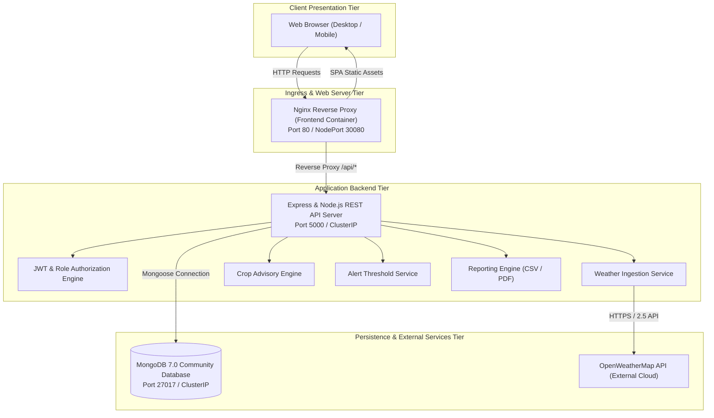
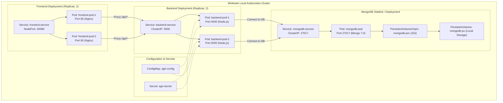

# System Architecture Specification
## Weather-Based Agricultural Advisory Platform
### SR University — Academic Year 2026–2027

---

## 1. Architectural Overview

The Weather-Based Agricultural Advisory Platform follows a modern **three-tier microservices architecture** containerized via Docker and orchestrated through Kubernetes.

---

## 2. Pod Topology in Kubernetes (Minikube)

---

## 3. Communication Protocols

| Source | Destination | Protocol | Port | Description |
| :--- | :--- | :--- | :--- | :--- |
| Browser | Nginx (Frontend) | HTTP / HTTPS | 80 / 3000 / 30080 | Single-Page Application delivery |
| Nginx | Node.js (Backend) | HTTP REST | 5000 | `/api/*` reverse proxy forwarding |
| Node.js | MongoDB | MongoDB Wire Protocol | 27017 | Read/write CRUD operations via Mongoose |
| Node.js | OpenWeatherMap | HTTPS | 443 | Real-time weather and 5-day forecast sync |

---

## 4. Scalability & Fault Tolerance

1. **Dual Replicas:** Both frontend and backend deployments specify `replicas: 2` with automatic pod scheduling across available nodes.
2. **Health Probes:**
   - **Readiness Probes:** Kubernetes withholds traffic until `/health` returns HTTP 200.
   - **Liveness Probes:** Deadlocked or out-of-memory processes are automatically terminated and restarted.
3. **Database Volume Resilience:** Persistent Volume Claims decouple database records from container lifecycles.
